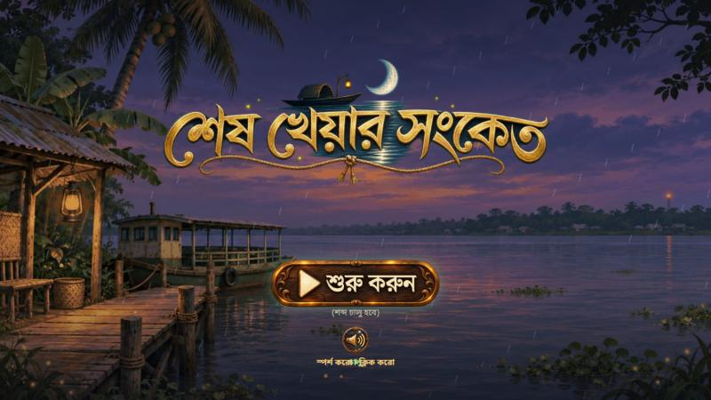
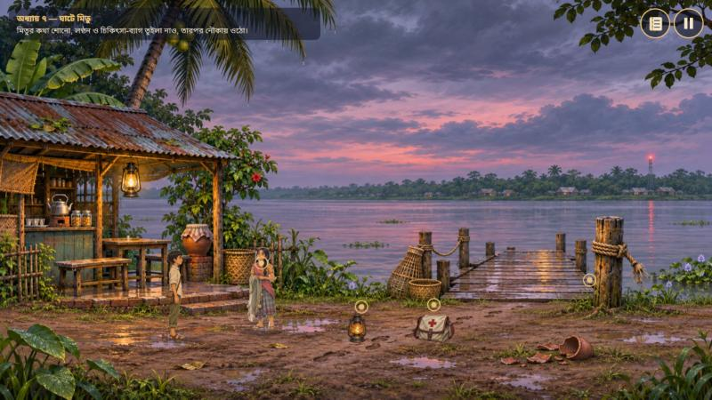
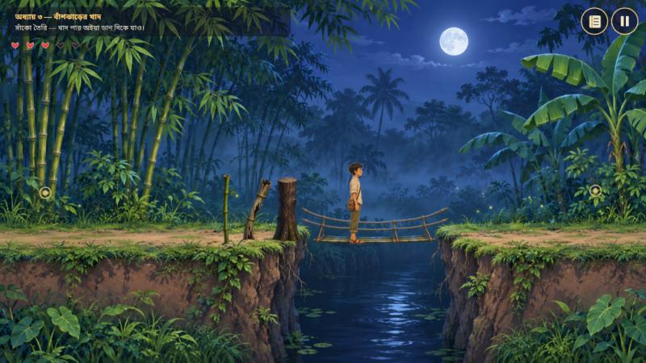
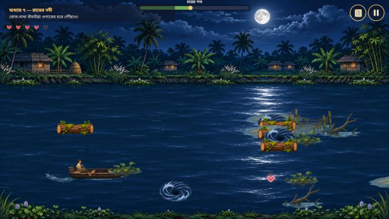
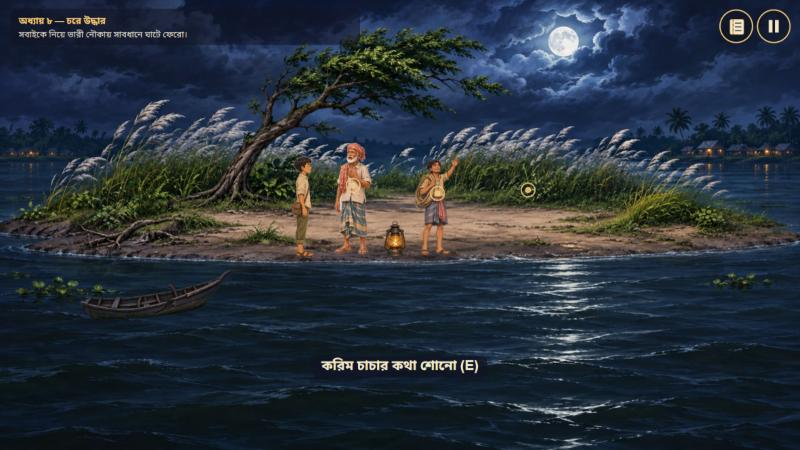
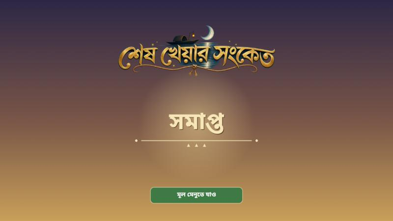

<div align="center">

# শেষ খেয়ার সংকেত
### *The Last Ferry's Signal*

**বরিশালের এক নদীপাড়ের রহস্য ও উদ্ধারের ২ডি গল্প-খেলা**
*A hand-crafted 2D story-driven mystery & rescue game set in a riverside village of Barishal, Bangladesh.*



`HTML5 Canvas` · `Vanilla JavaScript` · `No framework` · `No backend` · `100% Bangla (Barishali dialect)`

</div>

---

## 🎮 খেলা সম্পর্কে (About)

ঝড়ের রাতে রবিনকে আনতে শেষ খেয়ার মাঝি **করিম চাচা** নৌকা নিয়ে বের হন — আর ফেরেন না।
সকালে ঘাট খালি, দড়ি ছেঁড়া। খেলোয়াড় (ছেলে/মেয়ে বেছে নেওয়া যায়) চিহ্ন ও সাক্ষীদের কথা
মিলিয়ে সঠিক নদীপথ বের করে, বাঁশঝাড়–ভাঙা পথ–শেয়ালের মাঠ–সেচঘর পেরিয়ে, রাতের উত্তাল
নদী বেয়ে করিম চাচা ও আহত রবিনকে উদ্ধার করে ঘাটে ফেরে।

> A stormy night. The old ferryman vanishes on the river. You follow the clues, cross jungle
> and broken paths, fix the signal lamp, and row through a storm to bring everyone home.

---

## 📸 স্ক্রিনশট (Screenshots)

| ঘাটে মিতু — পথ-পরামর্শ ও সংগ্রহ | বাঁশঝাড়ের খাদ — নিজে বানানো সাঁকো |
|:---:|:---:|
|  |  |

| রাতের নদী — নৌকা-চালনা | চরে উদ্ধার — করিম ও রবিন |
|:---:|:---:|
|  |  |

<div align="center">



</div>

---

## ✨ ফিচার (Features)

- 🎭 **গল্প-চালিত ১০+ অধ্যায়** — অনুসন্ধান, ধাঁধা, প্ল্যাটফর্মিং ও নৌকা-চালনার মিশ্রণ।
- 🗺️ **সাক্ষী ও সূত্র মিলিয়ে সিদ্ধান্ত** — ভুল পথ বাছলে নিজে গিয়ে বিপদ দেখে ফেরা যায়।
- 🪢 **নিজে সাঁকো বানানো** — উপকরণ খুঁজে এনে দড়ি-বাঁশ দিয়ে খাদ পার।
- 🔦 **বর্তনী-ধাঁধা** — সেচঘরের নষ্ট সংকেতবাতি ঠিক করা।
- 🛶 **নৌকা-চালনা** — স্রোত, ভাসা গুঁড়ি, ঘূর্ণি ও ঝড় এড়িয়ে পার হওয়া।
- 👦👧 **ছেলে/মেয়ে খেলোয়াড়** — আলাদা ভঙ্গি, কণ্ঠ ও সমাপ্তি-ভিডিও।
- 🎙️ **বাংলা কণ্ঠ ও আঞ্চলিক সংলাপ** — বরিশালের কথ্য ভাষা।
- 📱 **ডেস্কটপ + মোবাইল** — কিবোর্ড ও টাচ, হাই-DPI, যেকোনো স্ক্রিনে মানানসই।

---

## 🕹️ নিয়ন্ত্রণ (Controls)

| কাজ | কিবোর্ড | টাচ |
|---|---|---|
| চলা | ◀ ▶ / A D | ◀ ▶ বোতাম |
| লাফ | Space / W / ↑ | ∧ বোতাম |
| দৌড় | Shift | — |
| কাজ / কথা | E / Enter | E বোতাম |
| নৌকা | ↑ ↓ ← → | ডি-প্যাড |
| বিরতি | Esc / P | ⏸ বোতাম |

> মোবাইলে **ল্যান্ডস্কেপ (পাশাপাশি)** মোডে সবচেয়ে সুন্দর।

---

## ▶️ কীভাবে চালাবে (Run locally)

গেমটি সম্পূর্ণ **স্ট্যাটিক** — শুধু একটা HTTP সার্ভার লাগে (সরাসরি `file://` চলবে না)।

```bash
# যেকোনো একটা স্ট্যাটিক সার্ভার, যেমন:
python -m http.server 8000
# তারপর ব্রাউজারে: http://localhost:8000
```

**অনলাইনে হোস্ট করতে (GitHub Pages), APK/EXE বানাতে, নিরাপত্তা ও সম্পূর্ণ গঠন** — দেখো 👉 **[`DOCUMENTATION.md`](DOCUMENTATION.md)**।

---

## 🧱 প্রযুক্তি (Tech)

- **Engine:** নিজস্ব JavaScript / HTML5 Canvas 2D (কোনো তৃতীয়-পক্ষ গেম-ইঞ্জিন নয়)।
- **Rendering:** hi-DPI backing-store + letterbox scaling (1280×720 logical)।
- **Audio:** Web Audio (procedural SFX) + বাংলা কণ্ঠ-ক্লিপ।
- **Structure:** মডুলার দৃশ্য-সিস্টেম + data-driven সংলাপ/ধাঁধা + asset manifest (fallback সহ)।
- **Font:** Noto Sans Bengali (SIL Open Font License)।

```
index.html · manifest.webmanifest · src/ · assets/{img,voice,audio,fonts}/ · assets/*.mp4
```

---

## 🙏 কৃতজ্ঞতা (Credits)

**নির্মাতা — Ahsun Ahmed Sun**
*গল্প লেখা · গেম ডিজাইন · সাউন্ড ডিজাইন · মান-নিয়ন্ত্রণ (QC)*

**সহযোগী (AI assistants):** **Claude** · **Gemini** · **ChatGPT**
*— কোড, শিল্প (ছবি/অ্যানিমেশন) ও কণ্ঠ তৈরিতে সহায়তা।*

---

## 📜 লাইসেন্স (License)

© 2026 **Ahsun Ahmed Sun**. All rights reserved.
এই গেমের গল্প, কোড, শিল্প ও শব্দের মালিকানা নির্মাতার — অনুমতি ছাড়া নকল/বিতরণ নিষেধ।

<div align="center">

*বাইচা থাক, আন্ধারে কেউ যেন না হারায়।* 🏮

</div>
